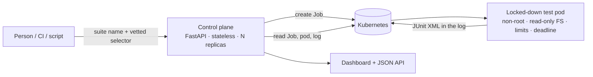

<div align="center">

# ☸️ k8s-test-runner

**Run test suites as isolated Kubernetes Jobs, behind a small stateless API and dashboard.**


</div>

---

## Why this exists

Test suites run best when every run gets a clean, resource-limited, disposable environment, and when anyone on a team can start one without owning a CI pipeline or a cluster login. This project is a small platform for that:

> **pick a suite** → **it runs as a Kubernetes Job in a locked-down pod** → **results and logs come back through an API and a dashboard**

It is deliberately small and opinionated: one control-plane service, no database, and a deployment that is secure by default.

## How it works



- **Stateless control plane.** Kubernetes is the only store. Each run is a Job labelled with its run id, and everything the API reports is derived from the Job and its pod. There is no database to run, back up or migrate, and the API can be scaled out or restarted at any time. History is bounded by `ttl_seconds_after_finished`.
- **Results without a volume or object store.** A pod's filesystem disappears when it ends, so the Job wraps the suite command in a tiny shell script that prints the JUnit XML to the end of the container log between two marker lines. The API reads it back and parses it. Any image works if it has `/bin/sh`, `base64` and `tr`, and writes JUnit XML to the path it is given.
- **Cancel without losing history.** Cancelling suspends the Job (stopping its pod) and marks it cancelled, so the run stays visible instead of vanishing.

## API

| Endpoint | Purpose |
|:--|:--|
| `POST /api/runs` `{"suite": "sample", "selector": "-k checkout"}` | Start a run (202 + `Location`) |
| `GET /api/runs` · `GET /api/runs/{id}` | List runs, or one run's status |
| `GET /api/runs/{id}/results?outcome=failed` | Parsed JUnit results (`failed`, `passed`, `skipped`, `all`) |
| `GET /api/runs/{id}/logs?tail=500` | Container log (the encoded results payload is hidden) |
| `POST /api/runs/{id}/cancel` | Cancel a pending or running run |
| `GET /api/suites` | Suites that can be run, and what selector options each allows |
| `GET /healthz` · `GET /` | Health check · dashboard |

Run status: `pending` → `running` → `succeeded` · `failed` · `timed_out` · `cancelled`. Errors use plain HTTP codes: 401 no token, 404 unknown suite or run, 409 not finished or already finished, 422 rejected selector, 429 too many active runs.

## Security by default

| Risk | Control |
|:--|:--|
| Caller runs arbitrary images or commands | Callers choose a **suite name**. Images, commands and resources live in a config a human owns |
| Argument injection via the selector | Only allow-listed options per suite; rejects `..`, absolute paths, drive letters, backslashes and shell characters. Arguments are passed as separate argv entries after the script, never interpolated into it |
| Escaping the container | Non-root user, no privilege escalation, **all capabilities dropped**, seccomp `RuntimeDefault`, **read-only root filesystem**, no service-account token mounted |
| Runaway runs and noisy neighbours | CPU/memory requests and limits, `activeDeadlineSeconds`, a cap on concurrent runs, and a namespace `ResourceQuota` |
| Test pods reaching internal systems | `NetworkPolicy`: no ingress; egress only to DNS and the public internet, with private ranges and the cloud metadata address blocked |
| Over-powered control plane | Namespace-scoped `Role`: create/get/list/patch Jobs, get/list pods, read logs. No secrets, no exec, no delete, no cluster-wide rights |
| Open API | **Refuses to start without `KTR_API_TOKEN`** unless you explicitly opt out for local development. Constant-time token comparison |
| Secrets in the config | Suites reference Kubernetes `Secret` keys. Values never appear in the config or the repo |
| Browser attacks on the dashboard | Strict Content-Security-Policy (no inline scripts), `nosniff`, no referrer |
| Namespace drift | The namespace enforces the `restricted` Pod Security Standard |

Reasons for choices that are easy to get wrong are in the code comments, and the deployment files are covered by tests (for example that the Role has no wildcards and no access to secrets).

## Quick start (no cluster needed)

The local executor runs suites as subprocesses, for development and demos. It is not isolated, so use it only with suites you trust.

```bash
git clone https://github.com/TheByteCodeHQ/k8s-test-runner.git
cd k8s-test-runner
python -m venv .venv && source .venv/bin/activate      # Windows: .venv\Scripts\activate
pip install -e ".[dev]"

cp suites.example.yaml suites.yaml && sed -i 's/^executor: kubernetes/executor: local/' suites.yaml
KTR_ALLOW_NO_AUTH=1 ktr-server --config suites.yaml     # PowerShell: $env:KTR_ALLOW_NO_AUTH="1"
```

Open http://127.0.0.1:8080, pick the `sample` suite and press **Run**. The sample has two deliberate failures, so you can see failures, assertion details and the log. From a terminal:

```bash
curl -s -X POST localhost:8080/api/runs -H 'Content-Type: application/json' -d '{"suite":"sample"}'
curl -s localhost:8080/api/runs/<id>/results?outcome=failed
```

## Deploy to a cluster

```bash
docker build -t ktr-server:dev .
docker build -t ktr-sample-suite:dev examples/sample-suite
# local cluster: kind load docker-image ktr-server:dev ktr-sample-suite:dev
# real cluster:  tag and push both to your registry, and update the image names in deploy/

kubectl apply -f deploy/namespace.yaml
kubectl -n test-runner create secret generic ktr-api-token --from-literal=token="$(openssl rand -hex 24)"
kubectl apply -k deploy
kubectl -n test-runner port-forward svc/ktr-server 8080:80
```

`scripts/e2e-kind.sh` does all of this on a throwaway kind cluster and asserts the sample results. It only touches the cluster it creates (`kind-ktr-e2e`) and runs manually from the **E2E on kind** workflow.

## Adding your own suite

```yaml
suites:
  api-tests:
    description: API regression tests
    image: registry.example.com/team/api-tests:1.4.2
    command: ["pytest", "-q", "--junitxml={junit}"]   # must write JUnit XML to {junit}
    allow_selector: true
    timeout_seconds: 900
    resources:
      requests: { cpu: 500m, memory: 512Mi }
      limits: { cpu: "2", memory: 1Gi }
    env: { BASE_URL: "https://staging.example.com" }
    secret_env:
      API_TOKEN: { secret: api-tests-secrets, key: api-token }
```

Any runner that can emit JUnit XML works (pytest, Maven Surefire, TestNG, Jest with a reporter), because results are read from that file rather than from console text.

## Project layout

```text
src/k8s_test_runner/
  api.py              FastAPI app: auth, endpoints, security headers, dashboard
  manifest.py         builds the hardened Job (typed Kubernetes models)
  executors/          kubernetes.py (stateless) and local.py (development)
  results.py          JUnit extraction from logs and parsing
  selector.py         selector vetting
  config.py           suite catalogue and validation
  static/             dashboard (plain HTML, CSS, JS: no build step)
deploy/               namespace, RBAC, deployment, policies, quota (kustomize)
examples/sample-suite/ pytest suite and its Dockerfile
scripts/e2e-kind.sh   end-to-end check on a throwaway kind cluster
tests/                73 tests
```

## Tests

```bash
pytest
ruff check .
```

The Kubernetes executor is tested against a fake Kubernetes API that models the Job and pod lifecycle: pending with an image pull error, running, succeeded, failed with an exit code, deadline exceeded, cancelled, and run-limit handling. The Job is built from the official typed models and checked field by field. The API is tested end to end with the local executor and real pytest runs. The deployment files are parsed and checked for the properties that matter, and rendered with `kubectl kustomize` when `kubectl` is available.

## Honest limits

- **The Kubernetes path has not been run against a real cluster by me.** It is verified against a fake API, typed manifests and an offline kustomize render. `scripts/e2e-kind.sh` is the real check, and I have not been able to run it yet. Expect small differences from real cluster behaviour until you do.
- Results travel in the log tail, which suits JUnit files up to a few MB. Large artefacts (videos, traces, reports) need an object store, which is on the roadmap.
- History is whatever Jobs still exist. There is no long-term run database by design.
- The `NetworkPolicy` is only enforced if your cluster's CNI supports it.
- Authentication is a single shared bearer token. Put it behind your own ingress and identity provider for anything beyond a small team.

## Roadmap

- Artefact upload (traces, videos, reports) to an object store, with links in the results
- Parallel sharding of one suite across several pods
- Per-user authentication and an audit trail
- Scheduled runs and a webhook when a run finishes

## License

MIT
